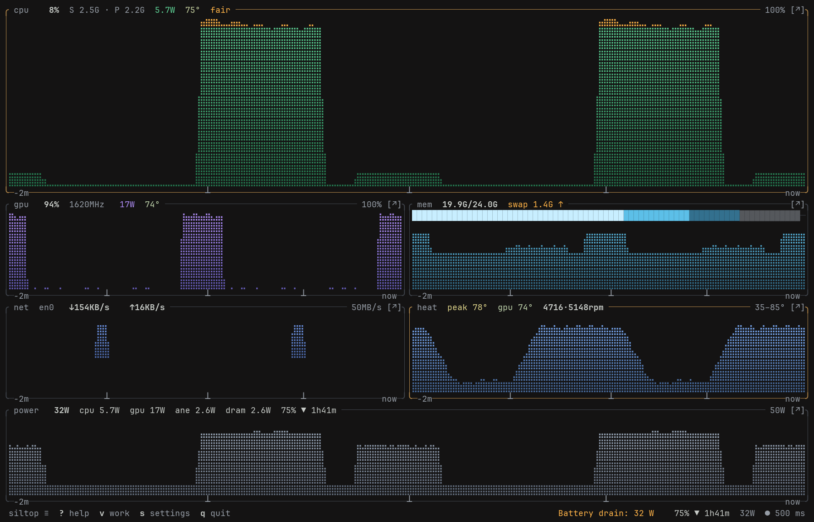
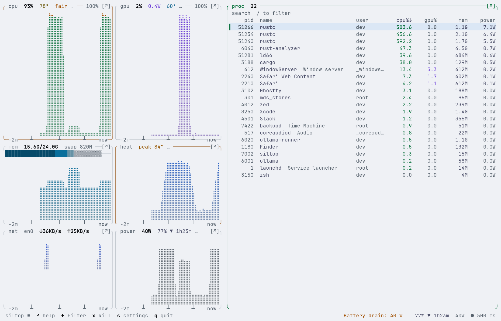

# siltop

[](https://github.com/CLoaKY233/siltop/actions/workflows/ci.yml)
[](https://github.com/CLoaKY233/siltop/releases/latest)
[](#license)

A terminal system monitor for Apple Silicon Macs (M1 to M5). It shows CPU, GPU, memory,
power, temperatures, fans, network, disk and a process table. Power and clock readings come
from the SMC and IOReport and do not need root.


<p align="center">
  
  
</p>

The screenshots are from `siltop --demo`, which plays a recorded 60-second session.

## What it reads

| Reading | Source |
| --- | --- |
| CPU load per cluster (Efficiency, Performance, Super) | Mach host statistics |
| CPU and GPU clocks | IOReport residency |
| CPU, GPU, ANE and DRAM power | IOReport energy counters |
| System power, temperatures, fans | SMC |
| Memory, swap, memory pressure | `sysctl`, Mach VM statistics |
| Battery charge, health, cycles, adapter | IOKit power sources |
| Processes: CPU, footprint memory, energy, GPU, disk | `proc_pid_rusage`, `sysctl` kinfo |

Things a Mac does not have are left out: Airs have no fan readings, desktops have no battery.
Values macOS will not give to a normal user, such as other users' process memory, show as `—`.

On macOS 27 some IOReport power counters only update every few seconds. siltop shows the last
real reading with its age (`≈ 4s`) instead of reporting 0 W in between.

### Compared with similar tools

|                                          | siltop | btop | macmon | asitop |
| ---------------------------------------- | :----: | :--: | :----: | :----: |
| CPU / GPU / ANE / DRAM power             | yes | no | yes | yes |
| Per-cluster clocks                       | yes | no | yes | yes |
| Temperatures and fans                    | yes | CPU temp | temps | no |
| Per-process energy and GPU               | yes | no | no | no |
| Process tree, filter, signals            | yes | yes | no | no |
| Runs without `sudo`                      | yes | yes | yes | no |
| Machine-readable output                  | JSON, NDJSON, Prometheus, CSV | no | JSON | no |

Measured on an M5 Pro at a 1 s interval, siltop uses about 1.3% of one CPU core, btop about
2.5% and macmon about 1.4%. Method and raw numbers:
[docs/research/12-self-cost.md](docs/research/12-self-cost.md).

## Install

Requires macOS on Apple Silicon.

Homebrew:

```sh
brew install cloaky233/tap/siltop
```

Prebuilt binary, into `~/.local/bin`:

```sh
mkdir -p ~/.local/bin && curl -fsSL https://github.com/CLoaKY233/siltop/releases/download/v1.2.1/siltop-v1.2.1-macos-arm64.tar.gz | tar -xz --strip-components 1 -C ~/.local/bin siltop-v1.2.1-macos-arm64/siltop
```

`siltop update --yes` updates a copy installed this way. Each
[release](https://github.com/CLoaKY233/siltop/releases) also has a `.zip` and SHA-256 files.
The binary is not notarized, so a copy downloaded with a browser is blocked by macOS until
you run `xattr -d com.apple.quarantine siltop`.

From source (Rust 1.98 or newer):

```sh
cargo install --git https://github.com/CLoaKY233/siltop --tag v1.2.1 siltop --locked
```

## Usage

```sh
siltop                                  # the dashboard
siltop --demo                           # a recorded session, no load needed
siltop -i 1s --theme paper              # sample every second, Paper theme
siltop --surface glance --no-mouse      # the compact view
siltop --json | jq .cpu.clusters        # one JSON sample (schema 1)
siltop --json-stream --count 3 -i 500   # NDJSON, one line per interval
siltop --diagnose                       # the verdict and its evidence
siltop doctor                           # what this Mac exposes, for bug reports
siltop line --style tmux                # one status line: "cpu 12% gpu 3% 8.4W 51°C"
siltop report week --json               # energy by app, peak temperatures
siltop agent install                    # alerts from a background LaunchAgent
siltop record --duration 10m            # record a session; `siltop replay` plays it
siltop serve                            # Prometheus metrics on 127.0.0.1:9101
siltop bench --duration 5m              # sustained CPU load test, reports throttling
siltop fleet studio mini.local          # several Macs side by side, over ssh
siltop completions zsh                  # also bash and fish; `siltop man` prints the manual
```

In the dashboard, `?` lists the keys, `m` opens the menu and `s` opens settings. The bottom
line shows a short verdict such as `All normal` or `Busy: rustc using 9.1 cores`.

The [user guide](docs/guide.md) covers every panel, the keys, settings, themes, alerts and
scripting.

## Configuration

Settings are in `~/.config/siltop/config.toml` (or under `$XDG_CONFIG_HOME`). The file is
only written when you change a setting, and comments you add are kept. Environment variables:

| Variable | Effect |
| --- | --- |
| `SILTOP_THEME=<name>` | Theme. `auto` (the default) builds one from the terminal's colours. |
| `SILTOP_KEYS=htop\|btop` | htop or btop key layout |
| `SILTOP_COLORS=truecolor\|256\|16\|none` | Override the colour-depth guess |
| `SILTOP_ICONS=nerd` | Nerd Font icons in panel titles |
| `SILTOP_NO_UPDATE_CHECK=1` | Never run the update check |
| `NO_COLOR=1` | No colour |

## Privacy

siltop sends nothing anywhere by default. The only network request is an update check
against the GitHub releases API, which is off until you turn it on; it runs `/usr/bin/curl` at
most once a day and sends only the version number in the User-Agent. `siltop serve` listens on
127.0.0.1 unless you pass `--addr`, and `siltop fleet` uses your own `ssh`. Crash reports are
written to disk and never sent.

## FAQ

**Why does my CPU read lower than Activity Monitor's?**
The CPU graph weights load by clock speed: a core busy at half its top clock counts as half
busy. The cluster rows show the plain busy share and the clock separately.

**Intel Macs, Linux?**
No. siltop uses Apple Silicon APIs. It compiles on other platforms but reads nothing there.

## How it works

Four crates, dependencies pointing one way (core ← metrics, ui ← bin):

| Crate | Contents |
| --- | --- |
| [`siltop-core`](crates/siltop-core) | Snapshot types, history store, config, verdicts |
| [`siltop-metrics`](crates/siltop-metrics) | Collectors (SMC, IOReport, IOHID, Mach, sysctl) and the sampler |
| [`siltop-ui`](crates/siltop-ui) | Themes, braille graphs, layout, widgets |
| [`siltop`](crates/siltop) | The binary: event loop, input, CLI, demo session |

A worker thread builds one `Snapshot` per interval and the UI draws it. Details are in
[crates/ARCHITECTURE.md](crates/ARCHITECTURE.md). Notes on the macOS APIs (SMC keys per chip,
reading IOReport energy without root, process data sources) are in
[docs/research/](docs/research).

## Contributing

Bug reports are welcome, especially from chips or Mac models not covered yet. Please include
the output of `siltop doctor`. [CONTRIBUTING.md](CONTRIBUTING.md) covers building and tests.

## License

MIT or Apache-2.0, at your option ([LICENSE-MIT](LICENSE-MIT), [LICENSE-APACHE](LICENSE-APACHE)).
Copyright © 2026 Lay Sheth.
